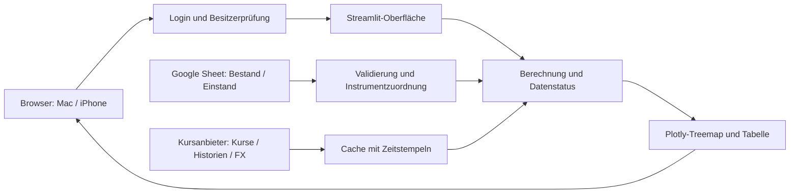

# Umsetzungsplan: privates Depot-Dashboard

Stand: 23. Oktober 2026. Dieser Plan enthält die bestätigten Nutzerwünsche und die daraus abgeleiteten technischen Entscheidungen. Die Anwendung ist noch nicht implementiert oder veröffentlicht.

## 1. Verbindliches Ziel

Das Dashboard wird **direkt online mit Login** bereitgestellt und ist am Mac und auf dem iPhone im Browser nutzbar.

- **Treemap-Fläche:** Wert der eigenen Position, nicht Börsenkapitalisierung.
- **Standardansicht „Kursentwicklung“:** Heute; umschaltbar auf 1 Woche, 1 Monat und 1 Jahr.
- **Button „Meine Entwicklung“:** Gewinn/Verlust der noch gehaltenen Positionen seit Kauf in Prozent.
- **Bestände und Einstandswerte:** aus dem bestehenden Google Sheet.
- **Projektverwaltung:** Python mit uv.

Das iPhone wird als Zielgerät für die Weboberfläche berücksichtigt. Eine Home-Bildschirm-Web-App bleibt eine Ausbauoption; eine native App-Store-App gehört nicht zur ersten Version. Entscheidungen, Herkunft und Alternativen stehen im [ADR-Verzeichnis](docs/adr/README.md).

## 2. Entscheidungsübersicht

| Thema | Entscheidung | Herkunft / ADR |
| --- | --- | --- |
| Produkt und Betrieb | Direkt online, persönliches Depot, Zugriff mit Login | Nutzervorgabe; [0001](docs/adr/0001-produktumfang.md) |
| Python-Projekt | uv, pyproject.toml, uv.lock | Nutzervorgabe; [0002](docs/adr/0002-python-uv-streamlit.md) |
| Oberfläche und Diagramm | Streamlit und Plotly; Berechnungen als separate Module | Technische Festlegung; [0002](docs/adr/0002-python-uv-streamlit.md) |
| Zugriff | OIDC-Login, zunächst Google, explizit zugelassene Besitzeridentität | Login vom Nutzer; Verfahren technisch; [0003](docs/adr/0003-login-und-zugriff.md) |
| Bestandsquelle | Bestehendes Google Sheet ausschließlich lesen | Quelle vom Nutzer; Integration technisch; [0004](docs/adr/0004-google-sheets.md) |
| Kursquelle | Zunächst yfinance; eindeutige Instrumentzuordnung und gekennzeichnete Ersatzwerte | Technisch, Abdeckung vor Veröffentlichung prüfen; [0005](docs/adr/0005-instrumente-und-kursdaten.md) |
| Periodenrendite | Reine, splitbereinigte Kursänderung in Handelswährung | Zeiträume vom Nutzer; Rechenregeln technisch; [0006](docs/adr/0006-kursentwicklung.md) |
| Persönliche Entwicklung | Unrealisierter Gewinn/Verlust seit Kauf in Prozent | Nutzervorgabe; [0007](docs/adr/0007-bewertung-und-einstand.md) |
| Depotwährung | EUR entsprechend den vorhandenen Einstands- und Bewertungsfeldern | Aus dem Sheet abgeleitet; [0007](docs/adr/0007-bewertung-und-einstand.md) |
| Gestaltung | Deutsch, dunkles Farbschema, Tabelle und mobile Bedienbarkeit | Technische Gestaltung; [0008](docs/adr/0008-treemap-und-bedienung.md) |
| Veröffentlichung | Python-Container über HTTPS; Anbieter und Budget noch offen | Betriebsart festgelegt; [0009](docs/adr/0009-betrieb-und-qualitaet.md) |

## 3. Geprüfte Ausgangslage

Im Projekt liegen `heatmap.py`, `requirements.txt`, `README.md` und eine lokale, nicht zu versionierende Tickerliste; `tickers.example.txt` enthält öffentliche Beispiele. Das Skript erzeugt eine HTML-Treemap aus einer Tickerliste, gewichtet nach Börsenkapitalisierung und kennt weder Stückzahlen noch Einstandswerte oder Login. uv ist installiert; das uv-Projekt ist noch nicht eingerichtet. Git und der GitHub-Remote sind inzwischen eingerichtet; sieben Epics und 31 Aufgaben sind im [Backlog](docs/backlog/README.md) verknüpft.

Der Google-Sheets-Zugriff über den verbundenen Connector wurde am 23. Oktober 2026 erfolgreich geprüft. Das allgemeine [Importschema](docs/DATA_SOURCE.md) beschreibt Anzahl, Instrumenttyp, Handelsplatzsymbol, Kurswährung, EUR-Bewertung und EUR-Einstand. Private Dokumentlinks, geprüfte Bereiche und konkrete Depotbefunde liegen ausschließlich in der ignorierten lokalen Dokumentation unter `docs/private/`.

Die Chat-Verbindung ist vom Laufzeitzugang des späteren Dashboards getrennt. Der Online-Dienst erhält einen eigenen lesenden Sheet-Zugang. Das Dashboard verändert das Blatt nicht.

## 4. Geplante Oberfläche

1. **Login-Seite:** Anmeldung und Status bei fehlender Berechtigung. Depotdaten werden erst nach Anmeldung und Besitzerprüfung geladen.
2. **Kopfbereich:** Depotname, Datenstand, Aktualisieren und Abmelden.
3. **Ansicht:** „Kursentwicklung“ / „Meine Entwicklung“. Kursentwicklung öffnet mit Heute; die persönliche Ansicht zeigt fest „Seit Kauf“ und blendet die Periodenauswahl aus.
4. **Kennzahlen:** Bewerteter Depotwert in EUR, aktive Positionen, Datenabdeckung und größte Gewinner/Verlierer. Die persönliche Ansicht ergänzt den Einstandsvergleich der berechenbaren Positionen.
5. **Treemap:** Name/Ticker und Prozentwert; Tooltip mit Instrument, Stückzahl, EUR-Wert, Depotanteil, Bezugswährung, Referenzdatum und Kursstand.
6. **Tabelle:** Suche, Sortierung und Filter nach Kategorie/Instrumenttyp. Auch nicht bewertbare Positionen bleiben hier sichtbar.
7. **Datenstatus:** Fehlende Kennung, fehlender Einstand, manuelle Bewertung, veraltete Daten oder fehlende Historie mit Bezug zur Position.

Flächen bleiben beim Ansichts- oder Zeitraumwechsel auf derselben Bewertung; Farben folgen der ausgewählten Kennzahl. Fehlende Renditen sind grau und als „n. v.“ beschriftet. Manuelle Werte ohne Zeitstempel heißen „Sheet-Wert, Kursstand unbekannt“. Eine Gesamtsumme mit solchen Ersatzwerten wird entsprechend gekennzeichnet.

## 5. Datenfluss und fachliche Regeln



- `Positionswert EUR = Anzahl × Instrumentkurs × FX nach EUR`.
- `Kursentwicklung % = (vergleichbarer aktueller Kurs / Referenzkurs − 1) × 100`.
- `Seit Kauf % = (Positionswert EUR / verbleibender Einstand EUR − 1) × 100`.
- Persönliche Gesamtwerte verwenden **dieselbe Menge gültiger aktiver Positionen** für Wert und Einstand. Einzelprozente werden nicht einfach gemittelt.
- Fehlender/ungültiger Einstand, null Einstand, „k. A.“, fehlende Historie und nicht zugeordnete Instrumente werden explizit behandelt. Fehlende Werte werden nicht zu null.
- Nullbestände werden aus aktiven Summen und Treemap ausgeschlossen. Derivate bleiben eigene Instrumente; ihre Underlyings ersetzen niemals ihre Kurse.
- Reine Kursentwicklung enthält keine Dividenden. Persönlicher Gewinn/Verlust verwendet den Einstand aus dem Sheet; Gebühren zählen nur mit, soweit dort enthalten. Realisierte Verkäufe, Ausschüttungen und Steuern werden nicht zusätzlich eingerechnet.
- Historische Vergleiche berücksichtigen Handelssitzungen, Börsenzeitzonen, Kalendergrenzen und Splits. Details: [ADR 0006](docs/adr/0006-kursentwicklung.md).

## 6. Arbeitspakete und Abhängigkeiten

Die folgenden Arbeitspakete sind als [sieben GitHub-Epics mit 31 Aufgaben](docs/backlog/README.md) angelegt. Dort stehen Prioritäten, relative Größen, konkrete Voraussetzungen und Abnahmekriterien. M6 beginnt früh mit Demo-Daten; die Nummerierung ist keine strikt serielle Reihenfolge.

| Schritt | Arbeiten und Ergebnis | Abschlusskriterium |
| --- | --- | --- |
| **M1 – Projektgrundlage** | uv-Projekt, Python-Version, Module, Konfigurationsbeispiel, synthetische Testdaten, Git | Installation mit Lockfile und Teststart funktionieren; reale Daten und Secrets sind ausgeschlossen |
| **M2 – Bestandsimport** | Lesender Sheet-Zugang, Spaltenmapping, Positionsmodell, Validierung und Zeilenstatus | Summenzeilen/Nullbestände werden nicht als aktive Positionen gewertet; Fehler bleiben sichtbar |
| **M3 – Instrumente und Kurse** | Provider-Mapping, Kurse/Historien/FX, Cache und Ersatzwerte | Identitäten sind geprüft; ungeklärte Instrumente gekennzeichnet; kein Underlying-Ersatz |
| **M4 – Berechnung** | Vier Perioden, EUR-Bewertung, Seit-Kauf-Prozente und passende Summen | Fachliche Tests für Splits, Kalender, Währungen und Datenlücken bestehen |
| **M5 – Dashboard** | Treemap, Ansicht/Zeitraum, Kennzahlen, Tabelle, Filter, Datenstatus | Konsistente Zahlen; Bedienung auch auf schmalem Bildschirm |
| **M6 – Login und Serverbetrieb** | OIDC, Besitzerprüfung, Secrets, Docker, HTTPS/WebSockets | Anonym und mit fremdem Konto bleiben Daten unzugänglich; erlaubtes Konto kann an-/abmelden |
| **M7 – Abnahme und Veröffentlichung** | Live-Abgleich, Authentifizierung im Zielbetrieb, mobile Prüfung, Betriebsanleitung/Rollback | Geschützte Online-URL funktioniert unabhängig vom Mac; Datenlücken und Betrieb sind dokumentiert |

M1, Importlogik und Berechnungen können mit synthetischen Daten vorbereitet werden. Echte Laufzeitdaten in M2 benötigen den eigenen Sheet-Zugang. M6 wird früh mit Demo-Daten entwickelt; reale Depotdaten dürfen erst nach funktionierender Zugriffssperre in einer erreichbaren Umgebung erscheinen. M7 hängt von allen vorherigen Ergebnissen ab.

## 7. Geplante Projektstruktur

```text
app.py
src/portfolio_dashboard/
    auth.py
    config.py
    models.py
    sheets.py
    instruments.py
    market_data.py
    cache.py
    calculations.py
    treemap.py
tests/
    fixtures/                  # ausschließlich synthetische Daten
docs/
    adr/
    DATA_SOURCE.md
    OPERATIONS.md              # entsteht mit der Umsetzung
.streamlit/
    config.toml
    secrets.toml.example       # nur Platzhalter
pyproject.toml
uv.lock
.python-version
.gitignore
.dockerignore
Dockerfile
README.md
PROJECT_PLAN.md
```

Geplanter Entwicklungsstart nach Umsetzung: `uv run streamlit run app.py`. Der Online-Dienst nutzt dasselbe gesperrte Dependency-Set im Container. Die vorhandene Tickerliste wird nicht als bestätigter Depotbestand übernommen.

## 8. Offene Konfiguration und Datenlücken

Diese Punkte blockieren die Dokumentation nicht; sie werden im jeweiligen Arbeitspaket geklärt.

| Punkt | Benötigt für | Vorgehen |
| --- | --- | --- |
| Hosting-Anbieter, Konto, Budget und URL | M6/M7 | Python-Container mit HTTPS, WebSockets, ausgehendem Datenzugriff und Secrets auswählen; keine Kostenentscheidung vorwegnehmen |
| Besitzeridentität und OIDC-Client | M6 | Vorgesehenes Konto freigeben; nicht aus dem Sheet-Namen ableiten |
| Laufzeit-Service-Account | M2/M6 | Nur das Depot-Sheet lesend freigeben; Credentials im Host hinterlegen |
| ETF- und Derivatekennungen | M3 | ISIN/WKN, Listing und Kursanbieter zuordnen; bis dahin markierte Sheet-Bewertungen |
| Unbekannte Einstandswerte | M4 | Persönliche Rendite dieser Positionen bleibt „n. v.“ |
| „Investiert (EUR)“ nach Teilverkäufen | M4 | Prüfen, ob der Einstand der verbleibenden Stücke enthalten ist |
| Zeitpunkte manueller Kurse | M3/M7 | Soweit möglich ergänzen; sonst keine Aktualität behaupten |

Anbieterauswahl und Produktkennungen werden nicht durch Vermutungen ersetzt. Ein gekennzeichneter Teilumfang ist möglich; eine vollständig aktuelle Depotbewertung setzt vollständige und ausreichend aktuelle Bewertungen voraus.

## 9. Abnahme

- Online-Zugriff über HTTPS funktioniert am Mac und iPhone ohne laufenden lokalen Rechner.
- Anonyme Besucher und nicht zugelassene Konten sehen keine Depotdaten; auch Downloads und alternative Datenpfade sind geschützt.
- Neuaufruf startet mit „Kursentwicklung / Heute“; alle vier Zeiträume aktualisieren die relevanten Werte konsistent.
- „Meine Entwicklung“ zeigt Gewinn/Verlust seit Kauf in Prozent mit EUR-Einstand; Periodenknöpfe sind darin ausgeblendet.
- Flächen bilden eigene Positionswerte ab. Aktien und darauf bezogene Derivate bleiben eigenständig.
- Treemap, Tabelle und Summen verwenden dieselbe Bewertungslogik und denselben Datenstand; Teilabdeckung ist sichtbar.
- Fehlende Werte erscheinen nicht als 0 %, alte/manuelle Werte nicht als aktuelle Echtzeitkurse.
- Sheet-Änderungen lassen sich durch Aktualisieren übernehmen; der Abruf verändert das Sheet nicht.
- Gezielte Berechnungs-, Import- und Zugriffstests sowie Browserprüfungen bestehen. Nachweise werden bei Umsetzung ergänzt.
- Betriebsanleitung enthält Start, Konfiguration, Secrets, Aktualisierung und Rollback.

## 10. Dokumentationspflege

Die [ADRs](docs/adr/README.md) sind die maßgebliche Entscheidungsakte. Der Plan beschreibt Umsetzung und Abnahme; das [Datenmapping](docs/DATA_SOURCE.md) die geprüfte Eingangsstruktur. Änderungen erhalten ein neues ADR mit Verweis auf das ersetzte Dokument. Bestätigte Nutzerwünsche, technische Festlegungen und offene Betriebsparameter bleiben unterscheidbar.
