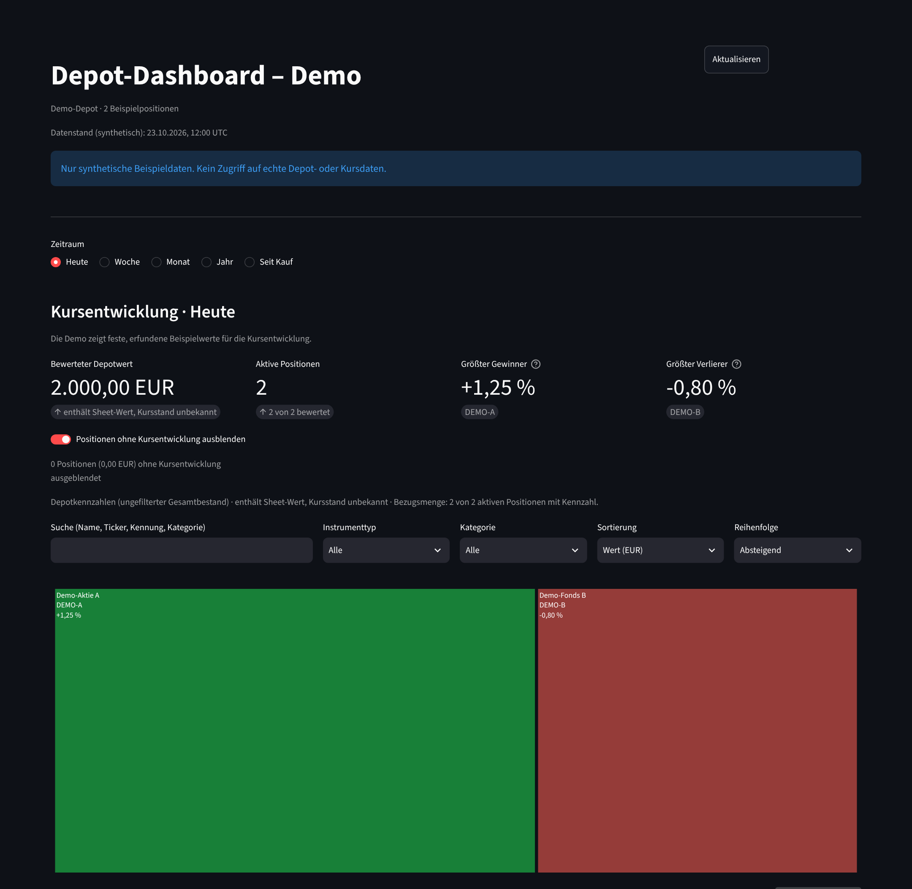
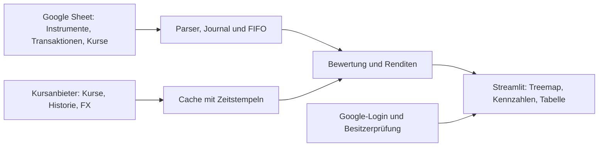
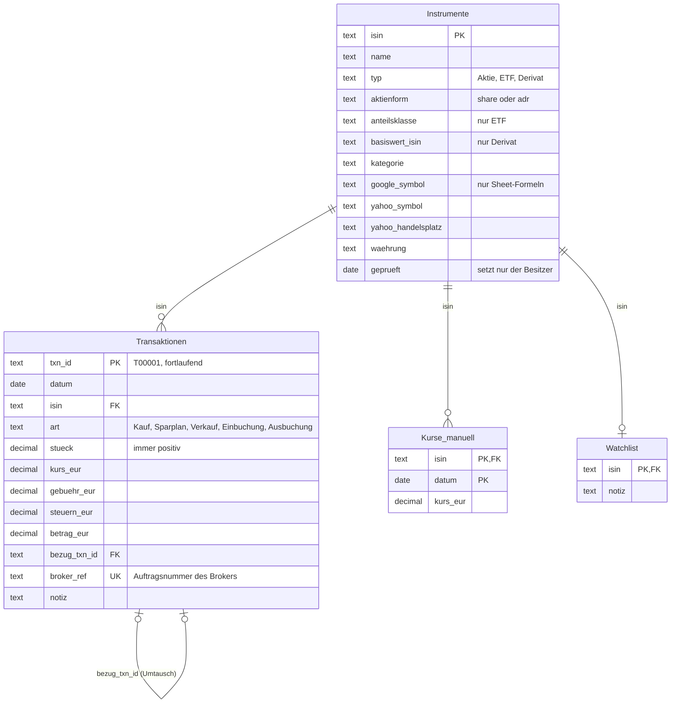

# Depot-Dashboard

**Ein privates Portfolio-Dashboard, das ein Wertpapierdepot nach Positionsgröße und Kursentwicklung als Treemap zeigt – mit nachvollziehbarer EUR-Bewertung, expliziter Datenqualität und einem geprüften FCFF-DCF-Rechenkern für den inneren Wert.**

**[Live-App öffnen](https://stocktreemap-analysis.streamlit.app/)** · Zugang nur für freigegebene Konten; der Screenshot unten zeigt den Demo-Modus mit synthetischen Beispieldaten



## Auf einen Blick

- **Problem:** Broker-Apps zeigen Positionen als Liste. Klumpenrisiken und die Verteilung von Gewinnen und Verlusten im Depot sind darin schwer zu erkennen.
- **Lösung:** Die Kachelfläche entspricht dem EUR-Wert der eigenen Position, die Farbe der Entwicklung im gewählten Zeitraum (Heute, Woche, Monat, Jahr, Seit Kauf). Kennzahlen, Tabelle und Datenstatus ergänzen die Karte.
- **Fachlicher Anspruch:** Jede Zahl ist auf eine dokumentierte Rechenregel zurückführbar. Fehlende Kurse, Wechselkurse oder Einstände werden nie stillschweigend zu null, sondern als „n. v.“ mit Grund ausgewiesen.
- **Technische Umsetzung:** Python 3.12, Streamlit und Plotly. Die Fachlogik liegt in reinen, UI-unabhängigen Modulen und ist durch über 1.100 automatisierte Tests mit synthetischen Daten abgesichert.
- **Datenschutz:** Echte Depotdaten werden erst nach Google-Login und serverseitiger Besitzerprüfung geladen. Repository, Tests und Demo enthalten keine realen Daten.

## Interaktive Analyse

Die Ansicht **Analyse** direkt hinter **Watchlist** überträgt die 29 Themen der Financial-Pipeline-V4
in Streamlit/Plotly: Geschäftszahlen, Kapitalqualität, Bewertung, Kursrisiko und
Marktumfeld. Hover, Zoom, Tabellen und CSV-Downloads ergänzen die Originalanalyse.
Beim Öffnen lädt **Microsoft** automatisch mit **Oracle, Alibaba und SAP** als
Vergleich. Unternehmen aus **Depot und Watchlist im Google Sheet** ergänzen die
Auswahl automatisch; Unternehmen und bis zu drei Vergleichsaktien lassen sich
darunter ändern. Nicht verfügbare Daten zeigen **n. v.**
oder **Noch nicht angebunden**. Der Einstieg zeigt den Aktienkurs mit Quartalszahlen;
die Themen führen
vom Überblick zum Deep Dive. Drei getrennte Glossare für Kennzahlen, Diagramme und
Datenquellen stehen am Seitenende.
Die gemeinsame dunkle CI gilt auch für die Treemap.
[Bedienung, Herkunft und Datenregeln](docs/EXPLORATION.md) · [Glossar](docs/glossary.md).

## Indizes

**Indizes** ergänzt Depot, Watchlist, Analyse und Innerer Wert. Die Auswahl erkennt
die Blätter **DAX, MDAX, Euro Stoxx 50, STOXX Europe 600, S&P 500, Nasdaq 100,
Dow Jones, Hang Seng und Nikkei 225** im bereits konfigurierten Google Sheet. DAX ist die Standardauswahl.
In A/B stehen die Überschriften **Unternehmen** und **Yahoo-Finance-Ticker**;
gelesen werden maximal 999 Unternehmen. Es sind keine zusätzlichen Secrets nötig.
Beim Öffnen lädt nur der gewählte Index. Zeitraumwechsel verwenden denselben
Datenstand; **Aktualisieren** lädt den aktuellen Index erneut. Die Daten bleiben
pro Sitzung und Index getrennt; am nächsten UTC-Tag wird automatisch neu geladen.

Die Seite zeigt Marktkapitalisierung, größten Gewinner und Verlierer, aktive
Positionen sowie eine Treemap mit Hover und darunter die vollständige Liste.
**Heute, Woche, Monat und Jahr** folgen der bestehenden Kursperioden-Logik.
Kachelflächen entsprechen den verfügbaren Unternehmens-Marktkapitalisierungen,
die Farben der Kursentwicklung. Das sind **keine offiziellen Indexgewichte**.
Kapitalisierungen werden nur bei gleicher Währung summiert. Bei gemischten
Währungen oder komplett fehlenden Kapitalisierungen erscheinen gleich große
Kacheln mit entsprechendem Hinweis. Fehlende Werte bleiben **NA**, keine Nullen.
Nicht unterstützte Handelsplätze zeigen „wird noch angebunden“. Kurskalender
stehen für die deutschen und US-Handelsplätze sowie für Tokio (`JPX`), Hongkong
(`HKG`), Indien NSE (`NSI`), Korea (`KSC`), Taiwan (`TAI`), Paris (`PAR`),
Amsterdam (`AMS`), Mailand (`MIL`), Madrid (`MCE`) und Zürich (`EBS`) bereit; deren
Feiertage liefert die Bibliothek `exchange_calendars`. Reicht ihre Feiertagsliste
nicht bis heute (Indien wird jährlich nachgetragen), zeigen die Kursperioden NA, bis
die Bibliothek aktualisiert ist (`uv lock --upgrade-package exchange-calendars`).
Tokio (11:30–12:30) und Hongkong (12:00–13:00) haben eine Mittagspause: Dann gilt
die Börse nicht als geöffnet, „Heute“ zeigt aber weiter den letzten Kurs des Vormittags.
Kursentwicklungen gelten in Handelswährung, ohne Umrechnung nach EUR; Hang Seng
notiert in HKD, Nikkei 225 in JPY.
Die Indexzusammensetzung wird im Sheet gepflegt, nicht automatisch ausgetauscht.

## Methodik

### 1. Bewertung in EUR

```text
Positionswert (EUR) = Stückzahl × Kurs in Handelswährung × FX-Kurs nach EUR
Depotanteil (%)     = Positionswert / Summe der bewerteten Positionswerte × 100
```

Kurse stammen von einem vom Besitzer geprüften Listing (ISIN, Handelsplatz, Währung). Kursquotierungen in Pence oder anderen Untereinheiten werden ausdrücklich normalisiert, Wechselkurse sind gerichtet. Positionen ohne gültigen Kurs oder FX-Kurs erhalten keine Kachel, bleiben aber in Tabelle und Datenstatus sichtbar. Details: [EUR-Bewertung](docs/EUR_VALUATION.md), [ADR 0007](docs/adr/0007-bewertung-und-einstand.md).

### 2. Kursentwicklung je Zeitraum

```text
Kursentwicklung (%) = (aktueller Kurs / Referenzschlusskurs − 1) × 100
```

Gerechnet wird in Handelswährung auf splitbereinigten Schlusskursen, ohne Dividenden und ohne Währungseffekte. Der Referenztag folgt dem Handelskalender des jeweiligen Börsenplatzes und berücksichtigt Zeitzonen, Feiertage und Kalendergrenzen. Details: [Kursperioden](docs/PRICE_PERIODS.md), [ADR 0006](docs/adr/0006-kursentwicklung.md).

### 3. Persönliche Rendite seit Kauf

```text
Gewinn/Verlust (EUR) = Positionswert − verbleibender Einstand
Seit Kauf (%)        = (Positionswert / verbleibender Einstand − 1) × 100
```

Depotsummen verwenden für Wert und Einstand dieselbe Menge gültiger Positionen. Einzelrenditen werden nicht gemittelt. Realisierte Gewinne, Ausschüttungen und Steuern sind bewusst nicht enthalten. Details: [Persönliche Rendite](docs/PERSONAL_RETURNS.md).

### 4. Innerer Wert (FCFF-DCF, Rechenkern)

```text
FCFF_t  = EBIT_t × (1 − T_t) + Abschreibungen_t − Capex_t − ΔNWC_t          t = 1..5
TV_5    = FCFF_6 / (WACC − g),   FCFF_6 = NOPAT_6 × (1 − g / ROIC)
Stammaktionärswert = Σ PV(FCFF) + PV(TV) + überschüssiges Cash + nichtoperative Vermögenswerte
                     − Finanzschulden − Vorzugsansprüche − Minderheitsansprüche
Wert je Aktie = Stammaktionärswert / verwässerte Aktien
```

Drei Szenarien (vorsichtig, Basis, optimistisch) und eine WACC-/Wachstums-Sensitivitätsmatrix. Gerechnet wird mit `Decimal` ohne Zwischenrundung. Ungültige Annahmen wie `g ≥ WACC` oder ein negativer nachhaltiger Cashflow sperren das Ergebnis mit einem expliziten Grund, statt eine Zahl auszugeben. Ein dominanter Terminalwert wird gekennzeichnet. Der Vergleich mit dem Börsenkurs weist Abschlag und Abstand zum Modellwert getrennt aus. Die Ansicht **Innerer Wert** zeigt Kurs, drei Szenariowerte und beide Bezugsgrößen für Depot und Watchlist, auch Aktien ohne Bewertung mit Grund. Die Detail- und Annahmenansicht zeigt historische Geschäftszahlen mit Quelle und Periode, lässt den Besitzer die drei Szenarien, manuelle Ergänzungen und Normalisierungen mit Begründung pflegen (Vorschau bei Änderung, Speichern nur ausdrücklich, Konflikterkennung) und erklärt Rechenweg, Terminalwertanteil, Sensitivität und Zielpreis. Details: [Bewertungsübersicht](docs/VALUATION_OVERVIEW.md), [Detail- und Annahmenansicht](docs/VALUATION_DETAIL.md), [ADR 0010](docs/adr/0010-innerer-wert-fcff.md), [DCF-Rechner](docs/DCF_CALCULATION.md), [Kursvergleich](docs/PRICE_COMPARISON.md).

### 5. Datenqualität

Jede Position trägt einen Status, etwa *Kurs fehlt*, *FX-Kurs fehlt*, *Instrument nicht zugeordnet*, *Sheet-Wert, Kursstand unbekannt* oder *Historie unvollständig*. Teilabdeckung und Ersatzwerte werden direkt an der Depotsumme ausgewiesen. Erwartete Werte, Toleranzen und Rundungsregeln sind in den [fachlichen Regressionen](docs/DOMAIN_REGRESSIONS.md) festgelegt.

## Architektur und Qualitätssicherung



- **Trennung von Fachlogik und Oberfläche:** Die Module unter `src/portfolio_dashboard` importieren weder Streamlit noch Datenanbieter. Ein Test prüft das in einem frischen Prozess mit gesperrtem Netzwerk.
- **Tests:** über 1.100 Pytest-Fälle, darunter Regressionstests mit festen Abnahmewerten. Netzwerkzugriffe sind in der Testumgebung gesperrt.
- **CI:** GitHub Actions führt bei jedem Pull Request gesperrte Installation (`uv.lock`), Ruff und Pytest aus.
- **Nachvollziehbare Entscheidungen:** zwölf [Architecture Decision Records](docs/adr/README.md) dokumentieren Produktumfang, Datenquellen, Rechenregeln, Zugriff und Betrieb.
- **Sicherheit:** OIDC-Login über Streamlit/Authlib. Vor jedem Datenzugriff prüft der Server erneut Issuer, Subject, Audience und Tokenlaufzeit. Secrets liegen ausschließlich in der Secret-Verwaltung des Hosts.

## Datenmodell im Google Sheet

Das Sheet wird wie eine kleine Datenbank geführt: ein Blatt pro Tabelle, Spaltennamen in Zeile 1, keine Formeln oder Summen in Eingabeblättern. Beschlossen und umgesetzt in [ADR 0012](docs/adr/0012-sheet-datenmodell.md): Die App liest `Instrumente`, `Transaktionen` und `Kurse_manuell` in einem Abruf.



- **Schlüssel:** Die ISIN identifiziert das Wertpapier, die `txn_id` die Transaktion. Positionen haben keine eigene ID, sie sind die Summe der Transaktionen je ISIN.
- **Abgeleitet statt gepflegt:** Stückzahl und Einstand der verbleibenden Stücke (FIFO) berechnet die App aus dem Journal; den realisierten Gewinn/Verlust rechnet das Journal mit, angezeigt wird er noch nicht. Ein Umtausch ist eine Ausbuchung plus eine verknüpfte Einbuchung, die den Einstand übernimmt.
- **Geprüfte Kurszuordnung:** Live-Kurse gibt es nur für Instrumente, bei denen der Besitzer `geprueft` gesetzt hat. Der Abgleich gegen die Antwort des Kursanbieters bleibt bestehen.
- **Ansichten:** Das bisherige Depotblatt bleibt als Formelansicht für den Menschen und wird von der App nicht gelesen. `Kurse_manuell` darf GOOGLEFINANCE-Formeln als Ersatzkurs enthalten. Die Agenten-Blätter hängen ebenfalls über die ISIN an `Instrumente`.

## Stand und Grenzen

| Bereich | Stand |
| --- | --- |
| Treemap, Kennzahlen, Filter, Tabelle, Datenstatus | umgesetzt, als Demo mit synthetischen Daten verfügbar |
| Google-Sheet-Import, Live-Kurse (yfinance), EUR-Bewertung, Renditen | umgesetzt; nur im privaten Modus mit Login |
| Login und Besitzerprüfung | umgesetzt |
| FCFF-DCF, Szenarien, Sensitivität, Kursvergleich | Rechenkern umgesetzt und getestet; Übersicht „Innerer Wert“ und Detail- und Annahmenansicht (Editor, Rechenweg, Sensitivität) umgesetzt; echte Annahmen trägt der Besitzer bei Nutzung ein |
| Watchlist aus dem Sheet | Kursabruf und Ansicht umgesetzt |
| Sheet-Datenmodell mit Transaktionsjournal ([ADR 0012](docs/adr/0012-sheet-datenmodell.md)) | umgesetzt: Bestand und FIFO-Einstand aus dem Journal, Kurszuordnung aus `Instrumente` |
| Fundamentaldaten (yfinance) | Abdeckung geprüft, Abruf, Normalisierung und geschützter Cache umgesetzt; Bewertungsübersicht und Annahmenerfassung umgesetzt; dauerhafter Speicher für Szenarien im Live-Betrieb offen (Besitzerentscheidung) |

Kursdaten stammen aus `yfinance`, einer inoffiziellen Schnittstelle; Kurse können verzögert sein. Das Dashboard ist ein privates Analysewerkzeug und keine Anlageberatung.

## Schnellstart

Voraussetzungen: [uv](https://docs.astral.sh/uv/) und Python 3.12.

```bash
uv sync --locked
uv run --locked streamlit run app.py      # Demo, ohne Netzwerk, Secrets oder Login
uv run --locked ruff check .
uv run --locked pytest
```

## Weiterführende Dokumentation

- [Entwicklung, Betrieb und Konfiguration](docs/DEVELOPMENT.md): Betriebsmodi, Umgebungsvariablen, Kurszuordnung, Login, PR-Ablauf
- [Umsetzungsplan](PROJECT_PLAN.md) und [Backlog](docs/backlog/README.md)
- [Architekturentscheidungen](docs/adr/README.md)
- Datenvertrag: [Importschema](docs/DATA_SOURCE.md), [Fachmodelle](docs/DOMAIN_MODELS.md), [Sheet-Parser](docs/SHEET_PARSER.md), [Sheets-Adapter](docs/SHEETS_ADAPTER.md), [Instrumentzuordnung](docs/INSTRUMENT_MAPPING.md)
- Marktdaten und Rechenregeln: [Marktdaten](docs/MARKET_DATA.md), [EUR-Bewertung](docs/EUR_VALUATION.md), [Kursperioden](docs/PRICE_PERIODS.md), [Persönliche Rendite](docs/PERSONAL_RETURNS.md), [Regressionen](docs/DOMAIN_REGRESSIONS.md)
- Innerer Wert: [Fundamentaldaten](docs/FUNDAMENTAL_MODELS.md), [Feldvertrag](docs/INTRINSIC_VALUE.md), [Abdeckung](docs/FUNDAMENTALS_COVERAGE.md), [Adapter und Normalisierung](docs/FUNDAMENTALS_PROVIDER.md), [Cache und Ladepfad](docs/FUNDAMENTALS_CACHE.md), [DCF-Rechner](docs/DCF_CALCULATION.md), [Kursvergleich](docs/PRICE_COMPARISON.md), [private Szenarien](docs/PRIVATE_SCENARIOS.md)
- Oberfläche und Betrieb: [Treemap](docs/TREEMAP.md), [Watchlist-Ansicht](docs/WATCHLIST_VIEW.md), [Bewertungsübersicht „Innerer Wert“](docs/VALUATION_OVERVIEW.md), [Detail- und Annahmenansicht](docs/VALUATION_DETAIL.md), [Watchlist-Kurse](docs/WATCHLIST_QUOTES.md), [Mobile Bedienung](docs/MOBILE_ACCESSIBILITY.md), [Container](docs/CONTAINER.md), [Streamlit Community Cloud](docs/COMMUNITY_CLOUD.md)
