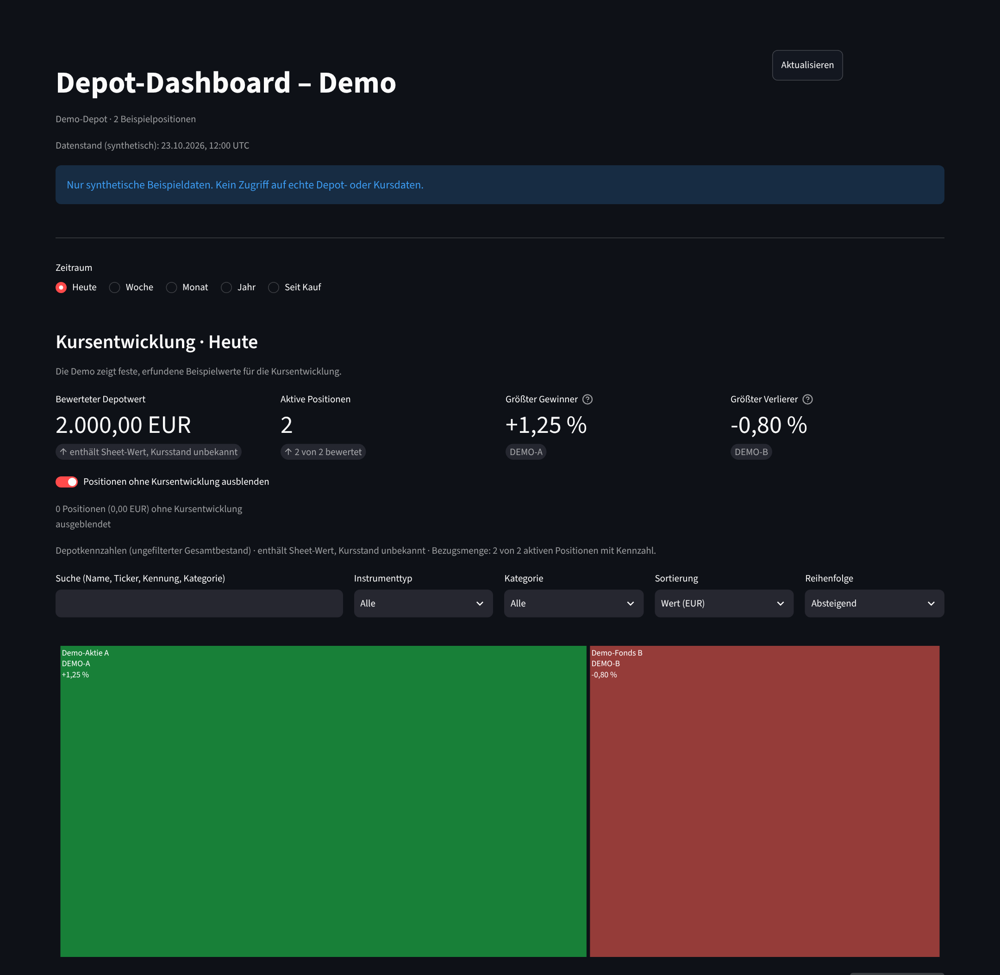
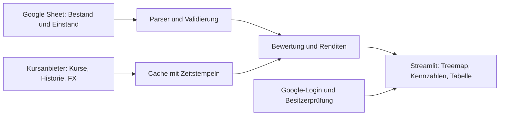

# Depot-Dashboard

**Ein privates Portfolio-Dashboard, das ein Wertpapierdepot nach Positionsgröße und Kursentwicklung als Treemap zeigt – mit nachvollziehbarer EUR-Bewertung, expliziter Datenqualität und einem geprüften FCFF-DCF-Rechenkern für den inneren Wert.**

<!-- TODO: Sobald die öffentliche Demo-App (Demo-Modus, ohne Secrets) läuft, diese Zeile einkommentieren und die URL eintragen:
**[Live-Demo öffnen](https://DEMO-SUBDOMAIN.streamlit.app)** · ausschließlich synthetische Beispieldaten, kein Login erforderlich
-->



## Auf einen Blick

- **Problem:** Broker-Apps zeigen Positionen als Liste. Klumpenrisiken und die Verteilung von Gewinnen und Verlusten im Depot sind darin schwer zu erkennen.
- **Lösung:** Die Kachelfläche entspricht dem EUR-Wert der eigenen Position, die Farbe der Entwicklung im gewählten Zeitraum (Heute, Woche, Monat, Jahr, Seit Kauf). Kennzahlen, Tabelle und Datenstatus ergänzen die Karte.
- **Fachlicher Anspruch:** Jede Zahl ist auf eine dokumentierte Rechenregel zurückführbar. Fehlende Kurse, Wechselkurse oder Einstände werden nie stillschweigend zu null, sondern als „n. v.“ mit Grund ausgewiesen.
- **Technische Umsetzung:** Python 3.12, Streamlit und Plotly. Die Fachlogik liegt in reinen, UI-unabhängigen Modulen und ist durch über 1.100 automatisierte Tests mit synthetischen Daten abgesichert.
- **Datenschutz:** Echte Depotdaten werden erst nach Google-Login und serverseitiger Besitzerprüfung geladen. Repository, Tests und Demo enthalten keine realen Daten.

## Methodik

### 1. Bewertung in EUR

```text
Positionswert (EUR) = Stückzahl × Kurs in Handelswährung × FX-Kurs nach EUR
Depotanteil (%)     = Positionswert / Summe der bewerteten Positionswerte × 100
```

Kurse stammen von einem vom Besitzer geprüften Listing (ISIN, Handelsplatz, Währung). Kursquotierungen in Pence oder anderen Untereinheiten werden ausdrücklich normalisiert, Wechselkurse sind gerichtet. Positionen ohne gültigen Kurs oder FX-Kurs erhalten keine Kachel, bleiben aber in Tabelle und Datenstatus sichtbar. Details: [EUR-Bewertung](docs/EUR_VALUATION.md), [ADR 0007](docs/adr/0007-bewertung-und-einstand.md).

### 2. Kursentwicklung je Zeitraum

```text
Kursentwicklung (%) = (aktueller Kurs / Referenzschlusskurs − 1) × 100
```

Gerechnet wird in Handelswährung auf splitbereinigten Schlusskursen, ohne Dividenden und ohne Währungseffekte. Der Referenztag folgt dem Handelskalender des jeweiligen Börsenplatzes und berücksichtigt Zeitzonen, Feiertage und Kalendergrenzen. Details: [Kursperioden](docs/PRICE_PERIODS.md), [ADR 0006](docs/adr/0006-kursentwicklung.md).

### 3. Persönliche Rendite seit Kauf

```text
Gewinn/Verlust (EUR) = Positionswert − verbleibender Einstand
Seit Kauf (%)        = (Positionswert / verbleibender Einstand − 1) × 100
```

Depotsummen verwenden für Wert und Einstand dieselbe Menge gültiger Positionen. Einzelrenditen werden nicht gemittelt. Realisierte Gewinne, Ausschüttungen und Steuern sind bewusst nicht enthalten. Details: [Persönliche Rendite](docs/PERSONAL_RETURNS.md).

### 4. Innerer Wert (FCFF-DCF, Rechenkern)

```text
FCFF_t  = EBIT_t × (1 − T_t) + Abschreibungen_t − Capex_t − ΔNWC_t          t = 1..5
TV_5    = FCFF_6 / (WACC − g),   FCFF_6 = NOPAT_6 × (1 − g / ROIC)
Stammaktionärswert = Σ PV(FCFF) + PV(TV) + überschüssiges Cash + nichtoperative Vermögenswerte
                     − Finanzschulden − Vorzugsansprüche − Minderheitsansprüche
Wert je Aktie = Stammaktionärswert / verwässerte Aktien
```

Drei Szenarien (vorsichtig, Basis, optimistisch) und eine WACC-/Wachstums-Sensitivitätsmatrix. Gerechnet wird mit `Decimal` ohne Zwischenrundung. Ungültige Annahmen wie `g ≥ WACC` oder ein negativer nachhaltiger Cashflow sperren das Ergebnis mit einem expliziten Grund, statt eine Zahl auszugeben. Ein dominanter Terminalwert wird gekennzeichnet. Der Vergleich mit dem Börsenkurs weist Abschlag und Abstand zum Modellwert getrennt aus. Die Oberfläche dafür ist noch in Arbeit. Details: [ADR 0010](docs/adr/0010-innerer-wert-fcff.md), [DCF-Rechner](docs/DCF_CALCULATION.md), [Kursvergleich](docs/PRICE_COMPARISON.md).

### 5. Datenqualität

Jede Position trägt einen Status, etwa *Kurs fehlt*, *FX-Kurs fehlt*, *Instrument nicht zugeordnet*, *Sheet-Wert, Kursstand unbekannt* oder *Historie unvollständig*. Teilabdeckung und Ersatzwerte werden direkt an der Depotsumme ausgewiesen. Erwartete Werte, Toleranzen und Rundungsregeln sind in den [fachlichen Regressionen](docs/DOMAIN_REGRESSIONS.md) festgelegt.

## Architektur und Qualitätssicherung



- **Trennung von Fachlogik und Oberfläche:** Die Module unter `src/portfolio_dashboard` importieren weder Streamlit noch Datenanbieter. Ein Test prüft das in einem frischen Prozess mit gesperrtem Netzwerk.
- **Tests:** über 1.100 Pytest-Fälle, darunter Regressionstests mit festen Abnahmewerten. Netzwerkzugriffe sind in der Testumgebung gesperrt.
- **CI:** GitHub Actions führt bei jedem Pull Request gesperrte Installation (`uv.lock`), Ruff und Pytest aus.
- **Nachvollziehbare Entscheidungen:** elf [Architecture Decision Records](docs/adr/README.md) dokumentieren Produktumfang, Datenquellen, Rechenregeln, Zugriff und Betrieb.
- **Sicherheit:** OIDC-Login über Streamlit/Authlib. Vor jedem Datenzugriff prüft der Server erneut Issuer, Subject, Audience und Tokenlaufzeit. Secrets liegen ausschließlich in der Secret-Verwaltung des Hosts.

## Stand und Grenzen

| Bereich | Stand |
| --- | --- |
| Treemap, Kennzahlen, Filter, Tabelle, Datenstatus | umgesetzt, als Demo mit synthetischen Daten verfügbar |
| Google-Sheet-Import, Live-Kurse (yfinance), EUR-Bewertung, Renditen | umgesetzt; nur im privaten Modus mit Login |
| Login und Besitzerprüfung | umgesetzt |
| FCFF-DCF, Szenarien, Sensitivität, Kursvergleich | Rechenkern umgesetzt und getestet; Oberfläche offen |
| Watchlist aus dem Sheet | Datenmodell umgesetzt; Ansicht offen |

Kursdaten stammen aus `yfinance`, einer inoffiziellen Schnittstelle; Kurse können verzögert sein. Das Dashboard ist ein privates Analysewerkzeug und keine Anlageberatung.

## Schnellstart

Voraussetzungen: [uv](https://docs.astral.sh/uv/) und Python 3.12.

```bash
uv sync --locked
uv run --locked streamlit run app.py      # Demo, ohne Netzwerk, Secrets oder Login
uv run --locked ruff check .
uv run --locked pytest
```

## Weiterführende Dokumentation

- [Entwicklung, Betrieb und Konfiguration](docs/DEVELOPMENT.md): Betriebsmodi, Umgebungsvariablen, Kurszuordnung, Login, PR-Ablauf
- [Umsetzungsplan](PROJECT_PLAN.md) und [Backlog](docs/backlog/README.md)
- [Architekturentscheidungen](docs/adr/README.md)
- Datenvertrag: [Importschema](docs/DATA_SOURCE.md), [Fachmodelle](docs/DOMAIN_MODELS.md), [Sheet-Parser](docs/SHEET_PARSER.md), [Sheets-Adapter](docs/SHEETS_ADAPTER.md), [Instrumentzuordnung](docs/INSTRUMENT_MAPPING.md)
- Marktdaten und Rechenregeln: [Marktdaten](docs/MARKET_DATA.md), [EUR-Bewertung](docs/EUR_VALUATION.md), [Kursperioden](docs/PRICE_PERIODS.md), [Persönliche Rendite](docs/PERSONAL_RETURNS.md), [Regressionen](docs/DOMAIN_REGRESSIONS.md)
- Innerer Wert: [Fundamentaldaten](docs/FUNDAMENTAL_MODELS.md), [Feldvertrag](docs/INTRINSIC_VALUE.md), [DCF-Rechner](docs/DCF_CALCULATION.md), [Kursvergleich](docs/PRICE_COMPARISON.md)
- Oberfläche und Betrieb: [Treemap](docs/TREEMAP.md), [Mobile Bedienung](docs/MOBILE_ACCESSIBILITY.md), [Container](docs/CONTAINER.md), [Streamlit Community Cloud](docs/COMMUNITY_CLOUD.md)
