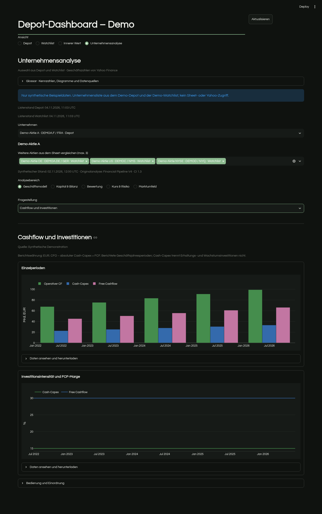

# Unternehmensanalyse: Financial Pipeline in Streamlit

Die Ansicht **Unternehmensanalyse** ergänzt Depot, Watchlist und Innerer Wert.
Sie portiert alle 29 Themen der Financial-Pipeline-V4 in native Plotly-Charts,
interaktive Tabellen und CSV-Downloads. Die Originalskripte, PNGs und die eingefrorene
Baseline im Pipeline-Repository bleiben unverändert.



## Start

```sh
uv sync --locked
uv run --locked streamlit run app.py
```

In der Navigation **Unternehmensanalyse** auswählen. Standardmäßig läuft das
Dashboard vollständig offline mit deutlich markierten synthetischen Beispielen.
Bekannte Symbole im Demo-Modus stehen **nicht** für echte Marktdaten.

Im bereits eingerichteten lokalen bzw. produktiven Modus bleibt der bestehende
Loopback-/Besitzerschutz des App-Einstiegs aktiv. Die Unternehmensauswahl verwendet
dieselben konfigurierten Google-Sheet-Quellen wie **Depot** und **Watchlist**:

1. **Unternehmen aus Sheet laden / aktualisieren** liest die Unternehmensliste
   ohne Marktkurse für das gesamte Depot abzurufen.
2. **Unternehmen** wählen; Name, Yahoo-Symbol, Handelsplatz und Herkunft stehen
   in der Auswahl. Bis zu drei weitere Sheet-Aktien können verglichen werden.
3. **Analysedaten laden / aktualisieren** lädt die gewählte Aktie, die Vergleiche
   und benötigte Benchmark-/FX-Reihen. Danach funktionieren Hover, Filter und
   Themenwechsel ohne erneuten Datenabruf.

Verwendet werden vorhandene Yahoo-Zuordnungen aus der Listing-Konfiguration oder
den unterstützten Mapping-Spalten im Sheet. Anzeigenamen und freie Ticker werden
nicht automatisch als Mapping interpretiert. ETFs und fehlende Zuordnungen bleiben
mit **n. v.** und einer Erklärung sichtbar. Identische Listings aus Depot und
Watchlist werden zusammengeführt; verschiedene Handelsplätze bleiben getrennt.
Yahoo-Metadaten müssen Symbol, Aktienart, Handelsplatz und Währung bestätigen.
Das Sheet wird nicht verändert. Bestände, Gewichte und Einstandswerte werden
nicht für die Unternehmensanalyse übernommen.

Snapshots liegen pro Auswahl ausschließlich in der Streamlit-Sitzung, maximal
acht gleichzeitig. Beim Unternehmenswechsel erscheint kein fremder Datenstand.
Nach einer Stunde wird das Alter markiert; Aktualisierung erfolgt ausdrücklich.
Bei fehlgeschlagenem Abruf bleibt nur ein vorhandener Stand derselben Auswahl mit
ursprünglichem Zeitstempel erhalten. Scheitert das Lesen einer Sheet-Quelle,
bleibt deren zuvor geladene Liste erhalten und wird entsprechend gekennzeichnet.
Einzelne fehlende Yahoo-Ressourcen sperren nur die betroffenen Analysen.

Das **Glossar · Kennzahlen, Diagramme und Datenquellen** steht direkt auf der Seite
auch vor dem Laden von Daten bereit. [Glossar und unverändertes Pipeline-Original](glossary.md).

## Gestaltung und Navigation

- **Geschäftsmodell:** Segmente, Wachstum/Margen, Jahres- und Quartalscashflow,
  Cashflow-Überleitung, Gewinnqualität.
- **Kapital & Bilanz:** ROIC, Kapitalverwendung, Entwicklung je Aktie, Bilanz,
  Zinsdeckung, Dividende und Ausschüttungsquote.
- **Bewertung:** Schätzungen/Revisionen, rekonstruiertes KGV, Portal-Multiplikatoren,
  Reverse DCF.
- **Kurs & Risiko:** EUR-Kurs, EPS-Ereignisse, Kerzen/Volumen, Aktienvergleich,
  Monatsrenditen, Drawdown, Risikoübersicht, Benchmark, Earnings-Reaktion.
- **Marktumfeld:** Analystenkonsens, Zieländerungen, Insider, Institutionen, Optionen.

Eine Fragestellung zur Zeit hält die Seite schnell und übersichtlich. Mehrere
Kennzahlen eines Themas stehen in getrennten Panels, niemals auf einer Doppelachse.
Hover, Zoom und Legendenauswahl funktionieren direkt in Plotly. Tabelle und Download
machen die Zahlen auch ohne Hover erreichbar. Monatsrenditen zeigen stets zwölf
vollständige Monate; der deaktivierte Zeitraumfilter erklärt die Ausnahme.

Die CI 1.3 liegt unter `src/portfolio_dashboard/ci.json`. `design.py` verwendet die
Tokens für Plotly und die Dashboard-Oberfläche. Die Treemap behält ihre fachliche
Farbzuordnung (Rot/Grau/Grün); Typografie, Flächen, Kennzahlenkarten und Kopfzeile
folgen nun derselben CI. Questrial wird lokal inklusive OFL-Lizenz unter `static/`
geliefert; keine Google-Fonts-Anfrage beim App-Aufruf. Die Streamlit-Theme-Datei
enthält die entsprechenden Grundfarben. Bei einer CI-Aktualisierung diese Datei
zusammen mit den Tokens abgleichen.

**Warum Plotly?** Bereits im Dashboard vorhanden, native Kerzen, Wasserfälle,
Heatmaps, Hover und Bildexport. Altair wäre für verknüpfte statistische Selektionen
interessant; ECharts für spezielle Interaktionen bei sehr großen Datenmengen.
Für diese Finanzanalysen entsteht durch eine zweite Chart-Bibliothek kein klarer
Mehrwert. Matplotlib bleibt im Pipeline-Projekt für statische Exportgrafiken.

## Datenregeln und Herkunft

Ausgangsstand: [Financial Pipeline, Commit 52133fc](https://github.com/FelixSchramm/real-time-stock-market-pipeline/tree/52133fcaba5a734567880cab191a826d1ade6bab/data_exploration/v4).
`calculations.py` übernimmt die V4-Rechenfunktionen; `data.py` übernimmt die
Statement-/FX-Konventionen mit einem neuen sessionbasierten Abruf. `charts.py`
portiert `business.py` und `market.py` ohne Matplotlib-Abhängigkeit.

- FX nur aus vorherigen Beobachtungen, maximal sieben Tage. Keine Zukunftskurse,
  keine aufgefüllten Aktienkurse. Native EUR/USD-Reihen brauchen keinen unnötigen FX-Abruf.
- EUR/USD und Kurs-/Gesamtrenditewahl gelten für die Vergleichsanalysen.
  Geschäftszahlen verwenden die gemeldete Berichtswährung und tatsächlichen
  Berichtsperioden. Kursdiagramme verwenden die bestätigte Handelswährung.
  Nicht bestätigte Untereinheiten oder fehlende FX-Reihen führen zu **n. v.**.
- Gesamtrendite ist eine Näherung aus `Adj Close`, ohne persönliche Steuern/Gebühren.
- TTM erfordert vier aufeinanderfolgende Quartale. FCF wird gegen CFO minus
  absoluten Cash-Capex geprüft. Fehlende Felder werden nicht als null interpretiert.
- Drawdown-Linie nutzt die geladene Vorgeschichte, die Risikoübersicht unterscheidet
  Zeitraum-Drawdown und Abstand zum Zehnjahreshoch.
- KGV verwendet bekannte Quartals-EPS erst ab dem Folgetag; fehlende Quartale
  unterbrechen die TTM-Basis. Median ist ausdrücklich kein fairer Wert. KGV und
  Earnings-Reaktionen sind nur für die geprüften US-Handelsplätze angebunden.
  KGV und Reverse DCF benötigen gleiche Kurs-/Berichtswährung und eine bestätigte
  Aktienbasis; unbestätigte Aktien-/ADR-Zuordnungen bleiben nicht verfügbar.
- Reverse DCF bleibt ein vereinfachter Eigenkapital-Cashflow-Proxy aus V4.
  Er ersetzt **nicht** den bestehenden FCFF-Rechenkern unter **Innerer Wert**.
- Geschäftssegmente zeigen **Noch nicht angebunden**: Yahoo liefert keine
  einheitliche Segmenttabelle. Die feste Microsoft-Berichtstabelle der alten
  Analyse wird nicht für andere Unternehmen angezeigt.
- Insider-Transaktionswerte benötigen bestätigte USD-Werte eines US-Listings.
  Marktvergleiche mit SPY/QQQ bzw. S&P 500/Nasdaq-100 sind ausdrücklich US-Referenzen.
- Analysten-, Eigentümer- und Optionsdaten sind Snapshots. Meldedatum und
  Abrufdatum sind unterschiedliche Größen; Optionsquotes werden auf Qualität gefiltert.

## Prüfung und Grenzen

Tests verwenden ausschließlich synthetische Daten und gesperrte IP-Netzwerkzugriffe:

```sh
uv run --locked pytest
uv run --locked ruff check src app.py tests
```

Tests prüfen die 29 Themen einschließlich ausdrücklich nicht angebundener
Analysen, Navigation, Rückkehr zum Depot, FX-Richtung/Alter, TTM-Lücken, ROIC,
Ausschüttungsperioden, KGV-Verfügbarkeit, DCF-Inversion und Quote-Filter.
Zusätzliche Tests prüfen Sheet-Mappings, Zusammenführung von Depot und Watchlist,
Unternehmenswechsel ohne fremde Cache-Daten, Erhalt des letzten Stands bei Fehlern,
Berichtswährungen, Metadatenabgleich und den Besitzerschutz vor dem Sheet-Zugriff.
Die Sheet-Anbindung wird mit synthetischen Adapterantworten getestet; ein Abruf
des privaten Google Sheets ist kein Bestandteil dieser Prüfung.
Abschlussprüfung am 04.11.2026: **1.799 Tests bestanden**, zwei bestehende
yfinance/Pandas-Deprecation-Warnungen; der gezielte Ruff-Lauf ist fehlerfrei.
Die Demo wurde in Chromium auf Desktop und mit 390 px Breite geprüft; der lokal
gelieferte CI-Font wurde geladen und es trat kein horizontaler Seitenüberlauf auf.

`ruff check .` findet im unveränderten Bestandsnotebook
`exploratory_analysis/01_msft_api_rundgang.ipynb` bereits vorhandene E401/I001/E701/E702-Verstöße.
Das Notebook wird auf Wunsch des Auftrags unverändert erhalten.
Der neue Code und die App-/Testmodule bestehen den gezielten Lint-Lauf.
Es wurde keine Produktivbereitstellung oder Änderung an Zugangsdaten vorgenommen.
