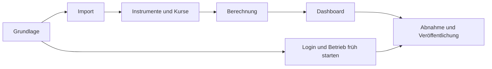

# Epics und Issues

Stand: 23. Oktober 2026. Sieben Epic-Issues und 31 Aufgaben sind auf [GitHub](https://github.com/FelixSchramm/stock_treemap_open_ai/issues) angelegt. Dies ist die Planung für die erste geschützte Online-Version, kein Umsetzungsnachweis.

GitHub führt den laufenden Status; [backlog.json](backlog.json) bewahrt den strukturierten Planungsstand. Die lokalen Epic-Dateien enthalten die vollständigen Aufgabenbeschreibungen. Fachliche Entscheidungen stehen weiterhin in den [ADRs](../adr/README.md).

## Epics

| Epic | GitHub | Aufgaben | Ergebnis |
| --- | --- | --- | --- |
| [M1 – Projektgrundlage und Entwicklungsablauf](M1.md) | [#1](https://github.com/FelixSchramm/stock_treemap_open_ai/issues/1) | 4 | Reproduzierbares uv-Projekt mit sicherer Konfiguration und automatischen Prüfungen. |
| [M2 – Bestandsimport aus Google Sheets](M2.md) | [#2](https://github.com/FelixSchramm/stock_treemap_open_ai/issues/2) | 4 | Bestände und Einstand werden ausschließlich lesend eingelesen, validiert und mit verständlichen Zeilenstatus versehen. |
| [M3 – Instrumentidentität, Kursdaten und Cache](M3.md) | [#3](https://github.com/FelixSchramm/stock_treemap_open_ai/issues/3) | 4 | Jede automatische Bewertung verwendet ein geprüftes Instrument; fehlende und alte Daten bleiben sichtbar. |
| [M4 – EUR-Bewertung und Renditeberechnung](M4.md) | [#4](https://github.com/FelixSchramm/stock_treemap_open_ai/issues/4) | 5 | Vier Kursperioden und persönlicher Gewinn/Verlust werden nach den festgelegten Regeln korrekt berechnet. |
| [M5 – Dashboard für Mac und iPhone](M5.md) | [#5](https://github.com/FelixSchramm/stock_treemap_open_ai/issues/5) | 5 | Eine deutsche Oberfläche macht Positionsgrößen, Entwicklung und Datenqualität verständlich sichtbar. |
| [M6 – Login und geschützter Serverbetrieb](M6.md) | [#6](https://github.com/FelixSchramm/stock_treemap_open_ai/issues/6) | 5 | Die App läuft unabhängig vom Mac über HTTPS und lädt Depotdaten erst nach Anmeldung und Besitzerprüfung. |
| [M7 – Abnahme, Betriebsanleitung und Veröffentlichung](M7.md) | [#7](https://github.com/FelixSchramm/stock_treemap_open_ai/issues/7) | 4 | Die geschützte Online-Version wird fachlich, technisch und mobil geprüft und nachvollziehbar ausgeliefert. |

## Reihenfolge

1. **Grundlage:** M1-02 starten; M1-01 nach Bereinigung des aktuellen Repository-Stands prüfen. Konfiguration, Datenverträge und CI folgen.
2. **Frühe Klärung:** Sheet-Laufzeitzugang (M2-03), Produktkennungen (M3-02), Kostenbasis (M4-01), Hosting (M6-01) und Login-Konfiguration (M6-02) anstoßen. Diese Aufgaben benötigen Eingaben des Besitzers; keine Geheimnisse in Issues eintragen.
3. **Vertikaler Demo-Ablauf:** Parser und Bewertung mit synthetischen Daten bauen, erste Oberfläche erstellen, Besitzerprüfung früh integrieren.
4. **Funktionsumfang:** Provider, Kalender/Splits, Cache, Renditen, vollständige Treemap/Tabelle und mobile Bedienung fertigstellen.
5. **Geschützter Zielbetrieb:** Container und Host zuerst mit Demo-Daten prüfen; erst danach reale Quellen verbinden.
6. **Abnahme:** Live-Abgleich, Zugriff und mobile Abläufe, Betriebsanleitung und getesteter Rollback; anschließend geschützte Veröffentlichung.

Das Diagramm zeigt den Überblick. Die konkreten Voraussetzungen stehen pro Aufgabe; viele Verträge und Berechnungen können mit Testdaten vor dem echten Zugang entstehen.

## Prioritäten, Größen und Abschluss

- **P0:** früh beginnen oder eine Voraussetzung klären. **P1:** nach verfügbarer Vorarbeit umsetzen. Alle Aufgaben gehören zur ersten Version.
- **S/M/L:** relative Größe und Unsicherheit, keine zugesagten Stunden oder Termine. Größere Aufgaben beim Start bei Bedarf weiter aufteilen.
- Labels: `epic`, `task`, `epic:M1` bis `epic:M7`, `priority:P0`/`priority:P1` und `needs-input` für Einrichtungs-/Klärungsaufgaben.
- Jedes Issue enthält Ziel, Umfang, prüfbare Abnahmekriterien, Abhängigkeiten und benötigte Eingaben. Die Epics verlinken ihre Kinder als Aufgabenliste; dies sind keine nativen GitHub-Sub-Issue-Beziehungen.
- Erledigt ist eine Aufgabe erst mit ihren Nachweisen. Ein Epic wird geschlossen, wenn seine Aufgaben und das übergreifende Abschlusskriterium erfüllt sind. Live- und Zugriffstests ersetzen keine synthetischen Tests und umgekehrt.
- Neue Funktionen außerhalb der ersten Version (native App/PWA, TWR/IRR, Transaktionsbuchhaltung) erhalten später eigene Entscheidungen und Issues.

## Aufgabenübersicht

| ID | Issue | Priorität | Größe | Voraussetzungen |
| --- | --- | --- | --- | --- |
| M1-01 | [Git-Repository und vertrauliche Konfiguration sauber trennen](https://github.com/FelixSchramm/stock_treemap_open_ai/issues/8) | P0 | S | – |
| M1-02 | [uv-Projekt, Python-Version und Modulstruktur einrichten](https://github.com/FelixSchramm/stock_treemap_open_ai/issues/9) | P0 | M | – |
| M1-03 | [Konfiguration, Secret-Beispiele und synthetische Fixtures vorbereiten](https://github.com/FelixSchramm/stock_treemap_open_ai/issues/10) | P0 | M | M1-02 |
| M1-04 | [CI und nachvollziehbare Entwicklungsprüfungen einrichten](https://github.com/FelixSchramm/stock_treemap_open_ai/issues/11) | P1 | S | M1-01, M1-02, M1-03 |
| M2-01 | [Positions-, Bewertungs- und Datenstatusmodelle definieren](https://github.com/FelixSchramm/stock_treemap_open_ai/issues/12) | P0 | M | M1-02 |
| M2-02 | [Sheet-Zeilen anhand des Schemas parsen und validieren](https://github.com/FelixSchramm/stock_treemap_open_ai/issues/13) | P0 | M | M2-01, M1-03 |
| M2-03 | [Eigenen lesenden Sheet-Laufzeitzugang einrichten](https://github.com/FelixSchramm/stock_treemap_open_ai/issues/14) | P0 | S | – |
| M2-04 | [Sheets-Adapter mit Fehlerstatus und Aktualisierung implementieren](https://github.com/FelixSchramm/stock_treemap_open_ai/issues/15) | P1 | M | M2-02, M1-03 |
| M3-01 | [Geprüfte Instrument- und Provider-Zuordnung implementieren](https://github.com/FelixSchramm/stock_treemap_open_ai/issues/16) | P0 | M | M2-01 |
| M3-02 | [ETF- und Derivatekennungen sowie Bewertungsquellen klären](https://github.com/FelixSchramm/stock_treemap_open_ai/issues/17) | P0 | M | – |
| M3-03 | [Kurs-, Historien- und FX-Provider anbinden](https://github.com/FelixSchramm/stock_treemap_open_ai/issues/18) | P1 | L | M3-01, M1-03 |
| M3-04 | [Cache, Backoff und nachvollziehbare Ersatzwerte integrieren](https://github.com/FelixSchramm/stock_treemap_open_ai/issues/19) | P1 | M | M3-03, M2-04 |
| M4-01 | [Einstandssemantik nach Teilverkäufen klären](https://github.com/FelixSchramm/stock_treemap_open_ai/issues/20) | P0 | S | – |
| M4-02 | [EUR-Bewertung, Währungseinheiten und Aggregation berechnen](https://github.com/FelixSchramm/stock_treemap_open_ai/issues/21) | P1 | M | M2-01, M3-01 |
| M4-03 | [Vier Kursperioden mit Kalender- und Splitregeln berechnen](https://github.com/FelixSchramm/stock_treemap_open_ai/issues/22) | P1 | L | M2-01, M3-03 |
| M4-04 | [Persönliche Rendite und gemeinsame Kostenbasis aggregieren](https://github.com/FelixSchramm/stock_treemap_open_ai/issues/23) | P1 | M | M4-02 |
| M4-05 | [Fachliche Regressionen über Import und Berechnung absichern](https://github.com/FelixSchramm/stock_treemap_open_ai/issues/24) | P1 | M | M2-02, M4-02, M4-03, M4-04 |
| M5-01 | [Deutsche App-Struktur und Ansichtswechsel bauen](https://github.com/FelixSchramm/stock_treemap_open_ai/issues/25) | P1 | M | M1-03, M2-01 |
| M5-02 | [Treemap nach eigenen Positionswerten rendern](https://github.com/FelixSchramm/stock_treemap_open_ai/issues/26) | P1 | M | M5-01, M4-02, M4-03, M4-04 |
| M5-03 | [Kennzahlen, Tabelle und gemeinsame Filter integrieren](https://github.com/FelixSchramm/stock_treemap_open_ai/issues/27) | P1 | M | M5-01, M4-02, M4-04 |
| M5-04 | [Aktualisieren, Lade- und Fehlerzustände anschließen](https://github.com/FelixSchramm/stock_treemap_open_ai/issues/28) | P1 | M | M5-01, M2-04, M3-04 |
| M5-05 | [Mobile Bedienung und zugängliche Darstellung prüfen](https://github.com/FelixSchramm/stock_treemap_open_ai/issues/29) | P1 | M | M5-02, M5-03, M5-04 |
| M6-01 | [Hosting-Anbieter, Budget und Ziel-URL entscheiden](https://github.com/FelixSchramm/stock_treemap_open_ai/issues/30) | P0 | S | – |
| M6-02 | [OIDC-Client und Besitzeridentität konfigurieren](https://github.com/FelixSchramm/stock_treemap_open_ai/issues/31) | P0 | S | – |
| M6-03 | [Login und serverseitige Besitzerprüfung vor Datenzugriff erzwingen](https://github.com/FelixSchramm/stock_treemap_open_ai/issues/32) | P0 | M | M1-03, M5-01 |
| M6-04 | [Reproduzierbaren Container und Betriebsparameter vorbereiten](https://github.com/FelixSchramm/stock_treemap_open_ai/issues/33) | P1 | M | M1-02, M1-03, M6-03 |
| M6-05 | [Geschützte Zielumgebung mit HTTPS bereitstellen](https://github.com/FelixSchramm/stock_treemap_open_ai/issues/34) | P1 | M | M6-01, M6-02, M6-03, M6-04 |
| M7-01 | [Live-Daten, Instrumentabdeckung und Einstand abgleichen](https://github.com/FelixSchramm/stock_treemap_open_ai/issues/35) | P1 | M | M2-03, M2-04, M3-02, M3-04, M4-01, M4-05, M6-05 |
| M7-02 | [End-to-End-Abnahme für Zugriff, Ansichten und Mobilgeräte durchführen](https://github.com/FelixSchramm/stock_treemap_open_ai/issues/36) | P1 | M | M7-01, M5-05, M6-05 |
| M7-03 | [Betriebsanleitung und Rollback praktisch verifizieren](https://github.com/FelixSchramm/stock_treemap_open_ai/issues/37) | P1 | M | M6-05 |
| M7-04 | [Geschützte Version veröffentlichen und Abschluss dokumentieren](https://github.com/FelixSchramm/stock_treemap_open_ai/issues/38) | P1 | S | M1-04, M7-02, M7-03 |

